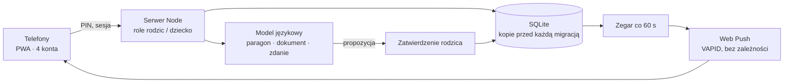

# Family Organizer App

Aplikacja na telefon dla rodziny z dwoma domami: kto ma dzieci w danym dniu, plan lekcji i zajęć, obowiązki z nagrodami, wspólne wydatki odczytywane ze zdjęcia paragonu, przypomnienia o lekach, sprawdzianach i terminach. Używana codziennie przez czworo domowników.

*A phone app for a family living in two homes: who has the kids on a given day, school and activity plans, chores with rewards, shared expenses read from a receipt photo, reminders for medicine, tests and deadlines. Used daily by four people.*

> Wizytówka projektu. Kod produkcyjny jest prywatny, bo zawiera dane rodziny. / Showcase repository. Production code is private because it holds family data.

---

## PL

### Problem
Dwoje rodziców, dwa domy, dwoje dzieci w szkole i na zajęciach. Ustalenia żyją w głowach i na czatach, a o plecaku na basen, lekach czy terminie sprawdzianu ktoś zawsze dowiaduje się za późno. Dzieci nie mają powodu, żeby same pilnować obowiązków.

### Rozwiązanie
Jedna aplikacja (PWA na Androida), cztery konta z rolą rodzica albo dziecka:
1. **Kalendarz opieki** z regułami stałymi i wyjątkami. Zamiana dnia działa jako prośba, którą drugi rodzic akceptuje; dopiero akceptacja zmienia grafik.
2. **Dzień dziecka**: oś czasu z lekcjami i zajęciami, lista obowiązków, plecak na jutro budowany z planu (basen = czepek, okulary, ręcznik).
3. **Gra w obowiązki**: gwiazdka za każdy obowiązek, tygodniowy próg zamienia gwiazdki w serduszka, a serduszka w nagrody zatwierdzane przez rodzica. Poziomy i odznaki za serie.
4. **Zmiana domu**: lista rzeczy do przekazania (torba, leki, dokumenty), odhacza ten, kto przekazuje.
5. **AI tam, gdzie oszczędza pisanie**: paragon ze zdjęcia do wydatków z kategorią i gwarancją, dokument zdrowia do przypomnień, dodawanie wpisu jednym zdaniem. Każdy wynik AI czeka na zatwierdzenie człowieka.
6. **Powiadomienia push**: rano plan dnia dla dziecka, po południu „spakuj się na jutro”, leki z eskalacją do rodzica po 30 minutach, terminy zdrowia na 30 i 7 dni przed.

### Architektura

### Decyzje projektowe
- **Prośba zamiast edycji.** Zmiana grafiku opieki nigdy nie dzieje się jednostronnie; to zasada z życia, nie z kodu.
- **AI proponuje, człowiek zatwierdza.** Model nie zapisuje niczego sam; każdy odczyt paragonu czy dokumentu jest szkicem.
- **Serwer decyduje o losowaniu i nagrodach.** Dziecko nie oszuka gry z poziomu telefonu.
- **Rodzic widzi, dziecko odhacza.** Plecak i torba: rodzic ma podgląd stanu, ale odhaczyć może tylko dziecko (serwer zwraca 403).
- **PIN-y tylko jako hashe scrypt**, blokada po 5 błędach, różna długość PIN-u dla rodzica i dziecka.
- **Web Push napisany od zera** na wbudowanej kryptografii (VAPID ES256 + aes128gcm), zweryfikowany niezależną biblioteką w testach.
- **Kopia bazy przed każdą migracją**, testy end to end na instancji testowej z kopią danych, nigdy na żywej bazie.

### Efekt
- Działa produkcyjnie od października 2026, codziennie używana przez dwoje rodziców i dwoje dzieci.
- 13 rund rozwoju, każda z osobnym zestawem testów end to end (od 18 do 133 kontroli na rundę).
- Działa też na starszych telefonach z Androidem 8 (zapas dla przeglądarek bez jednostek `dvh`).

### Stack
Node.js · SQLite · PWA (Service Worker, Web Push) · OpenRouter (Gemini Flash) · Playwright · Caddy · Linux VPS · systemd · borg

---

## EN

**Problem.** Two parents, two homes, two school kids. Agreements live in heads and chats; the swimming kit, medicine or test date always surfaces too late.

**Solution.** One PWA with parent and child roles: a custody calendar where swaps are requests the other parent accepts, a child's day view with lessons, activities and an auto-built backpack list, a chores game (stars, weekly hearts, rewards approved by a parent), a handover checklist, AI that turns receipt and document photos into draft entries a human approves, and push notifications for daily plans, packing, medicine and health deadlines.

**Design choices.** Requests instead of edits; AI proposes, humans approve; the server owns randomness and rewards; scrypt-hashed PINs with lockout; Web Push built from scratch on node:crypto and verified by an independent library in tests; a database backup before every migration.

**Result.** In daily production use since October 2026 by a family of four; 13 development rounds, each with its own end-to-end test suite.

---

 Zbudowane przez <a href="https://cyfrownia.com">Cyfrownię</a> · Grudziądz

